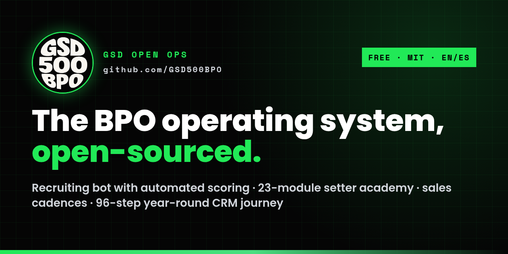

# GSD Open Ops: open-source appointment-setting & BPO operations kit

**A free, MIT-licensed operating system for running an appointment-setting team: a WhatsApp recruiting bot with automated candidate scoring, a 23-module setter academy (English + Spanish), sales cadence templates, CRM ownership rules, and a 96-step year-round CRM journey for home-service businesses.**

[](LICENSE)


[](CONTRIBUTING.md)

> **We give away the sauce.** This is what we run every day at [GSD 500 BPO](https://gsd500bpo.com/?utm_source=github&utm_medium=readme&utm_campaign=open-ops): how we recruit, test, train and manage bilingual appointment setters for water-treatment dealers and home-service companies. One founder built it, with Claude as the engineering partner. Take it, fork it, run it.
>
> **Want us to run it for you? → [Book a strategy call](https://gsd500bpo.com/strategy-call?utm_source=github&utm_medium=readme&utm_campaign=open-ops)**



*Español: [README.es.md](README.es.md)*

---

## What this is

GSD Open Ops is the complete playbook and code behind a working appointment-setting BPO. It covers the four jobs every sales-support operation has to get right: **hiring** people who can actually talk to US customers (a WhatsApp bot that screens applicants, scores a 1-minute English video locally, and only sends recruiters the people who pass), **training** them (a bilingual academy that takes a new setter from day 1 to running calls alone), **running the floor** (speed-to-lead, one-open-task, the 3-day / 5-day follow-up cadence, who owns what), and **never wasting a lead** (a 96-step, 365-day email + SMS journey that pivots by trade and season). Everything is CRM-agnostic: written for Zoho, mapped to GoHighLevel, HubSpot and Salesforce.

## Who it's for

- **Call centers and BPOs** that hire bilingual SDRs / appointment setters and want screening that runs while they sleep.
- **Water-treatment dealers** building an in-house appointment desk or a follow-up system for homeowners who didn't buy.
- **Home-service companies** (HVAC, solar, roofing, windows, storm restoration) that need sales cadence templates and a year-round nurture plan.
- **Solopreneurs and small agencies** who want to see how a one-person company runs recruiting, training and CRM automation with AI.
- **Sales trainers and team leads** looking for an open appointment-setter training curriculum (EN/ES) with quizzes and a QA scorecard.
- **Developers** who want a working example of a WhatsApp Cloud API recruiting bot with local speech scoring (Whisper + wav2vec2 + LanguageTool, no paid APIs).

## What's inside

| Folder | What it is | Start here |
|---|---|---|
| [`recruiting/`](recruiting/) | **Ramón**, the WhatsApp recruiting bot: intake → WhatsApp steps → 1-minute English video → local speaking score (clarity, fluency, grammar, accent) → English / Sales / Typing prequal test → voice roleplay → pass/fail gate → interview task. Dry by default, capped, consent-first | [`recruiting/README.md`](recruiting/README.md) |
| [`training/`](training/) | The **appointment-setter academy**: 23 modules × EN/ES (~17.5 hours), quizzes with explanations, the 3-3-3 graduation, SOP templates and the role map ("who's what and who's where") | [`training/README.md`](training/README.md) |
| [`crm/`](crm/) | **CRM rules and sales cadences**: speed to lead (15 min), one open task, 3-day overdue rule, TA-1..4 first-contact attempts, FU-1..6 post-appointment follow-up, recruiting data schema | [`crm/README.md`](crm/README.md) |
| [`journeys/24-step/`](journeys/24-step/) | **24-step nurture engine**: 24 emails + 6 texts over 90 days, editable plain-text templates, and the runner that sends them safely (dry run by default, one message per channel per step, daily caps, STOP forever, circuit breaker, kill switch) | [`journeys/24-step/README.md`](journeys/24-step/README.md) |
| [`alerts/`](alerts/) | **Speed-to-lead and hot-lead alerts**: new lead / reply → team chat + CRM task with a deadline; open +5, click +10, reply +25 → Hot at 70, Critical at 90; escalation when nobody calls in 15 minutes | [`alerts/README.md`](alerts/README.md) |
| [`data-pipeline/`](data-pipeline/) | **List pipeline**: business data you're allowed to use (your CRM, open data, OpenStreetMap, manual research) → clean → dedupe → enrich → import files for Zoho CRM, GoHighLevel and HubSpot. No scrapers for sites that forbid them | [`data-pipeline/README.md`](data-pipeline/README.md) |
| [`safety/`](safety/) | **The shared outbound guard** every sender uses, the team-chat notifier, and the 15-check going-live list | [`safety/README.md`](safety/README.md) |
| [`playbooks/`](playbooks/) | The **96-Step Year-Round Prospect Journey**: what to do with every lead that didn't buy (PDF + importable CSV + JSON with merge fields and exit rules) | [`playbooks/README.md`](playbooks/README.md) |
| [`docs/`](docs/) | **Getting started (non-technical)**, the build story, use cases, GitHub/SEO settings | [`docs/GETTING-STARTED.md`](docs/GETTING-STARTED.md) |
| [`USE-CASES.md`](USE-CASES.md) | 8 step-by-step use cases: dealer nurture, storm-season pivot, 100 applicants → top 10, speed-to-lead routing, door-to-door data, a setter trained in a week, CRM-agnostic setup, B2B outreach | [`USE-CASES.md`](USE-CASES.md) |

## Quick start

```bash
git clone https://github.com/GSD500BPO/gsd-open-ops.git
cd gsd-open-ops

# 1) Recruiting bot: dry run, no network, no keys
cd recruiting/ramon
cp .env.example .env && chmod 600 .env
python3 tests/test_offline.py          # prints "OK 10 checks"

# 2) The 24-step journey engine: dry run, prints what it WOULD send
cd ../../journeys/24-step
python3 engine.py enroll contacts.example.csv && python3 engine.py run --ignore-window

# 3) Alerts and the list pipeline: dry run on the example files
cd ../../alerts && python3 alerts.py process events.example.jsonl --now 2026-03-02T16:10:00Z
cd ../data-pipeline && python3 pipeline.py run samples/registry-export.example.csv && cat out/report.md
cd ..

# 4) The 96-step plan: open the steps in any spreadsheet or import them into your CRM
#    playbooks/96-step-journey/96-step-journey.csv

# 5) The academy: read it on GitHub, or paste it into Zoho Learn / any LMS
#    training/curriculum/welcome.md  →  ...  →  graduation-333.md
```

New here and not technical? Follow **[docs/GETTING-STARTED.md](docs/GETTING-STARTED.md)**, step by step.

Then, in order:
1. **Hire with Ramón.** Follow the go-live steps in [`recruiting/README.md`](recruiting/README.md) (`TALENT_LIVE=0` for a day, then your own phone only, then everyone).
2. **Train with the academy.** One course per phase, one lesson per module; graduate people with 3-3-3.
3. **Run the floor with the CRM rules.** Turn [`crm/ownership-rules.md`](crm/ownership-rules.md) and [`crm/cadences.md`](crm/cadences.md) into tasks, stages and workflow rules.
4. **Build a clean list** with the [list pipeline](data-pipeline/) and **wire alerts** ([`alerts/`](alerts/)) so every new lead and reply reaches a human fast.
5. **Never waste a lead.** Run the [24-step engine](journeys/24-step/) (or import the 96 steps into your CRM) only after the [15-check going-live list](safety/README.md#going-live-checklist-15-checks).

Search the repo for `{{` and `example.com` to find every value you need to fill in.

## How we built a BPO as a solopreneur with AI

GSD 500 BPO started as one person, a CRM and a lot of leads nobody was calling back. Instead of hiring a department for each job, we wrote the departments ourselves, from scratch, with Claude as the engineering partner and a small crew of bots doing the repetitive work:

1. **Cadences first.** Before any automation: written rules for how fast a lead is called, how many attempts, when the next task is due. The [3-day / 5-business-day cadence](crm/cadences.md) and the [ownership rules](crm/ownership-rules.md) came out of reviewing real calls.
2. **Niche data.** Lists of water-treatment businesses built from data we're allowed to use (our own CRM, open data, OpenStreetMap, and manual research where a site doesn't allow automation), then [cleaned, de-duplicated and enriched](data-pipeline/) into the CRM with the fields that drive automation.
3. **Journeys.** A [24-step nurture](journeys/24-step/) per trade, then four of them chained into the [96-step year-round journey](playbooks/96-step-journey/) that pivots from water treatment to roofing/storm, windows and HVAC as the seasons change.
4. **Alerts.** Speed-to-lead: a new lead triggers a same-minute email + text and an [alert](alerts/) to the person who must call it. Replies, opens and clicks raise a lead score; hot leads go to a human.
5. **Smart leads to setters.** Fields like language, owner/renter and preferred channel decide who calls and what they say. Leads rotate; a 15-minute rule and a 3-day overdue rule keep anyone from sitting on them.
6. **Recruiting at scale.** [Ramón](recruiting/) screens every applicant on WhatsApp, scores a 1-minute English video on our own server, and grades a prequal test, so a pile of applications becomes a short list of people worth interviewing.
7. **Training.** The [academy](training/) turned everything above into 23 bilingual modules with quizzes and a 3-3-3 graduation.

The full story, chapter by chapter: **[docs/how-we-built-it.md](docs/how-we-built-it.md)**.

## Stack

Python 3 (standard library for the pipeline) · faster-whisper, wav2vec2, SpeechBrain, LanguageTool (local speaking score, no paid APIs) · WhatsApp Cloud API · Zoho Recruit, CRM, Mail, Cliq, Learn (mappable to GoHighLevel / HubSpot / Salesforce) · Supabase (storage + public talent page) · plain HTML for the test and roleplay pages · systemd + cron. Built with Claude.

## FAQ

**Is this really free for commercial use?**
Yes. Everything is MIT-licensed: use it in your company or for clients, change it, sell services on top of it. Keep the license notice.

**Do I need Zoho CRM?**
No. The rules and cadences only need tasks with due dates and owners, a stage field, notes and tags. The journey ships as CSV/JSON with a field map for Zoho CRM, GoHighLevel and HubSpot. The recruiting bot talks to Zoho Recruit today; swapping the ATS calls is a contained change in `talent.py`.

**How does the recruiting bot score candidates?**
Three gates: a prequal test (composite ≥ 65 and English ≥ 70), a 1-minute English video, and a speaking score ≥ 60 out of 100 (35% clarity, 25% fluency, 25% grammar, 15% neutral accent), all computed locally. Thresholds are environment variables. A human always makes the hiring decision. Details: [`recruiting/docs/speaking-score.md`](recruiting/docs/speaking-score.md).

**What is a 96-step prospect journey?**
A 365-day email + SMS plan for leads that saw your offer but didn't buy: 4 seasonal phases × 3 chapters × 8 steps, each with a theme, angle, goal and CRM tag. Any reply pauses it and goes to a human; STOP ends it permanently. See [`playbooks/`](playbooks/).

**What is the 3-day / 5-day follow-up rule?**
After a conversation, the next task is due in 3 days; with no conversation, in 5 business days. Every lead always has exactly one open task; a task overdue 3 business days lets another rep claim the record. See [`crm/cadences.md`](crm/cadences.md).

**Is the training only for water treatment?**
The scripts were written for water-treatment dealers and in-home water analyses, but the structure (opener, gatekeeper, discovery, pitch, booking, objections, voicemail, SMS) works for HVAC, solar, roofing and restoration. Swap the discovery questions and objections.

**Does the WhatsApp bot spam people?**
No. It's dry until you set `TALENT_LIVE=1`, caps automated messages per candidate per day, saves state before every send so nothing repeats, treats STOP as permanent, and never publishes a candidate without their explicit YES.

**Can you set this up for my team?**
Yes, that's our business. **[Book a strategy call](https://gsd500bpo.com/strategy-call?utm_source=github&utm_medium=readme&utm_campaign=open-ops)**.

## Contributing

New roleplay scenarios, translations, CRM mappings (HubSpot, GoHighLevel, Salesforce) and use cases are welcome. Read [CONTRIBUTING.md](CONTRIBUTING.md) and the [Code of Conduct](CODE_OF_CONDUCT.md). Never commit real candidate or customer data.

## Built by GSD 500 BPO

Bilingual appointment setting, CRM automation and back-office teams from Bogotá, Colombia. *We Get Sh\*t Done.*

**Want us to run it for you? → [Strategy call](https://gsd500bpo.com/strategy-call?utm_source=github&utm_medium=readme&utm_campaign=open-ops)**

License: [MIT](LICENSE) · Security: [SECURITY.md](SECURITY.md) · Contributing: [CONTRIBUTING.md](CONTRIBUTING.md) · Cite: [CITATION.cff](CITATION.cff)
