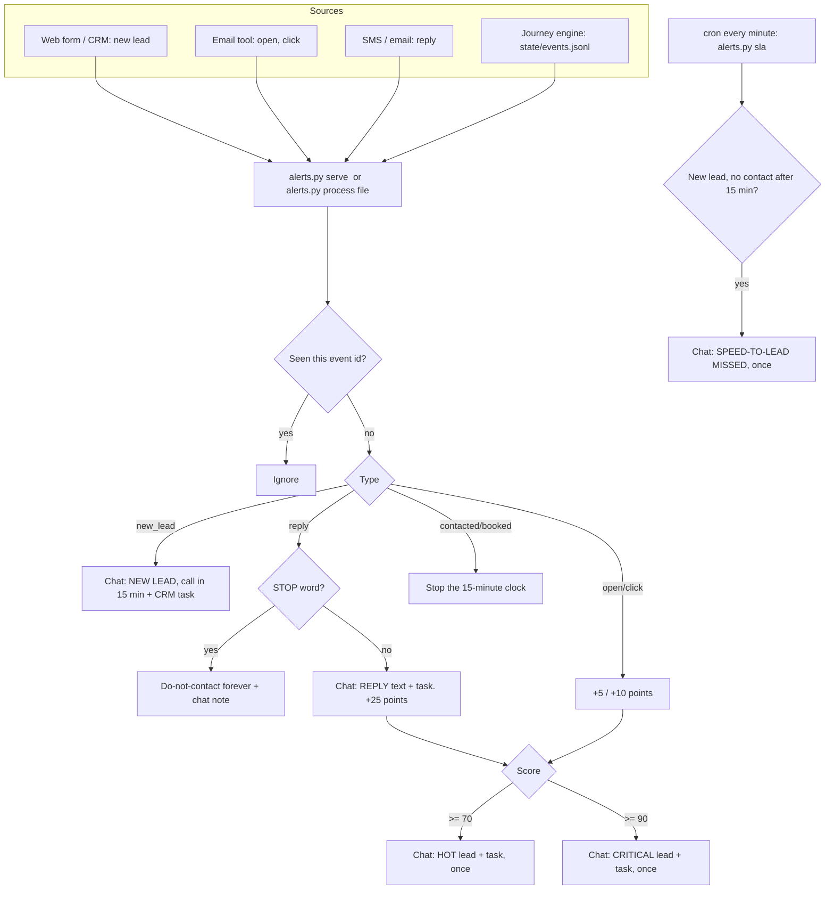

# Alerts: speed to lead, replies and hot leads

A small program that tells **your team** the moment something needs a human: a new lead, a reply, or a lead whose engagement score just got hot. It can also create a CRM task with a deadline, and it escalates any new lead nobody called in time.

It never messages a lead. It only talks to your team (team chat + CRM tasks).

- Dry run by default. `--live` to post.
- One alert per lead per event, ever. Replies are capped per lead per day.
- Circuit breaker, kill switch, and a log of everything.
- Python 3.9+, standard library only.

---

## What it does (1 paragraph)

Your CRM, forms, email tool or the journey engine send it **events** (new lead, email opened, link clicked, reply, STOP, contacted, booked). For a **new lead**, it posts "NEW LEAD: call within 15 minutes" to your team chat and creates a CRM task due in 15 minutes. For a **reply**, it posts the reply text and creates a task to answer it. Every open (+5), click (+10) and reply (+25) adds to a **score**: at 70 the lead is **Hot** (call today), at 90 it's **Critical** (call now). A **STOP** marks the lead do-not-contact. Every minute, `sla` checks for new leads nobody contacted within 15 minutes and escalates them once.

## Diagram



## Scoring

| Event | Points | Notes |
|---|---|---|
| `email_open` | +5 | At most 20 points from opens in total. Privacy features and scanners open emails automatically, so opens are a weak signal |
| `email_click` | +10 | |
| `reply` | +25 | Also creates a "reply" alert and task |
| **Hot** | score ≥ 70 | One alert + task "call today" (due in 4 hours) |
| **Critical** | score ≥ 90 | One alert + task "call now" (due in 15 minutes) |

All numbers are in `config.json`.

## Files

| File | What it is |
|---|---|
| `alerts.py` | The program (commands below) |
| `crm.py` | How tasks are created: dry run, or a webhook to your CRM / automation tool |
| `config.example.json` | Points, thresholds, speed-to-lead minutes, caps. Copy to `config.json` |
| `.env.example` | Chat webhook URL, CRM webhook URL, shared secret. Copy to `.env`, `chmod 600 .env` |
| `events.example.jsonl` | Example events (fake data) |
| `tests/test_alerts.py` | Offline tests |
| `../safety/` | Kill switch, STOP list, breaker, team-chat notifier |

---

## 5-minute quick start (dry run)

Nothing here posts to chat or creates a task.

```bash
cd alerts

# 1. Process the example events (pretend it's 16:10 UTC that day)
python3 alerts.py process events.example.jsonl --now 2026-03-02T16:10:00Z
#    -> NEW LEAD x3, REPLY x2, HOT LEAD (score 75), OPT-OUT, and the CRM tasks it WOULD create

# 2. Process them again: nothing new (each event id is handled once)
python3 alerts.py process events.example.jsonl --now 2026-03-02T16:10:00Z

# 3. Speed-to-lead check: who waited more than 15 minutes?
python3 alerts.py sla --now 2026-03-02T16:10:00Z
#    -> SPEED-TO-LEAD MISSED for the leads nobody marked "contacted"

# 4. See scores and alerts
python3 alerts.py status

# 5. Run the tests (from the repo root)
cd .. && python3 -m unittest discover -s alerts/tests -v
```

Start over: delete `alerts/state/alerts-dry-run.db`.

### Event format

One JSON object per event (one per line in a `.jsonl` file, or POSTed to `serve`):

```json
{"id": "evt-123", "type": "new_lead", "lead_id": "L-1", "name": "Ana", "phone": "+15550000001",
 "email": "ana@example.com", "text": "", "ts": "2026-03-02T15:00:00Z"}
```

| Field | Required | Notes |
|---|---|---|
| `type` | yes | `new_lead`, `email_open`, `email_click`, `reply`, `stop`, `contacted`, `booked` |
| `lead_id` | yes | Your CRM record id (email or phone also work) |
| `id` | recommended | Unique event id. If missing, one is made from the content, so exact repeats are ignored |
| `ts` | recommended | When it happened (ISO 8601). Used for the 15-minute clock |
| `name`, `phone`, `email` | no | Shown in the alert |
| `text` | for replies | The reply text. STOP words turn a reply into a `stop` |

Your CRM uses other field names? Map them in `config.json`: `"field_map": {"Lead_Id": "lead_id", "Event": "type"}`.

---

## Where to plug it in

You need three connections: **events in** (new leads, replies, opens/clicks), **tasks out** (optional), **chat out**.

**Events in** has two options:
- `python3 alerts.py serve` runs a tiny receiver at `http://127.0.0.1:8787/events`. Put it behind HTTPS (a reverse proxy like Caddy or nginx) before your CRM can reach it. It requires `WEBHOOK_SECRET`, sent as header `X-Webhook-Secret`, as `?secret=` in the URL, or as an HMAC signature in `X-Signature-SHA256`. It accepts JSON or form-encoded bodies.
- Or have your tool write events to a file and run `python3 alerts.py process that-file.jsonl` from cron.

**Tasks out:** many CRMs can create the task themselves in the same workflow that sends the event. That's often simplest: let the CRM create the task, and use this module for chat alerts, scoring and the 15-minute escalation. Or set `"crm": {"type": "webhook"}` and point `CRM_TASK_WEBHOOK_URL` at something that creates a task.

**Chat out:** set `ALERT_WEBHOOK_URL` (see [`safety/README.md`](../safety/README.md#team-chat-formats)).

**Mark contacted:** send a `contacted` event when a rep logs a call (or a `booked` event), so the 15-minute clock stops.

### Zoho CRM

- **New lead:** a workflow rule on Leads, "on create", with a **Webhook** action (Setup > Automation > Actions > Webhooks). URL: your `serve` address + `/events?secret=...`. Add parameters: `type` as a custom value `new_lead`, `lead_id` from the Lead Id field, plus the name, phone and email fields.
- **Contacted:** a workflow rule when a call is logged or a field like Lead Status changes, with a webhook sending `type=contacted`.
- **Task:** use Zoho's own **Create Task** workflow action on the same rule (due today, assigned to the lead owner). Keep this module's CRM type as `dryrun`.
- **Chat:** Zoho Cliq can receive channel messages through a webhook URL with a webhook token. Check Cliq's docs for the exact URL for your data center.
- **Replies:** come from your SMS provider (inbound webhook) or your email tool, not from Zoho itself.

### GoHighLevel

- **New lead:** a workflow with the **Contact Created** (or Form Submitted) trigger and a **Webhook** action pointing at `serve`.
- **Replies:** the **Customer Replied** trigger plus a **Webhook** action sends `type=reply` with the message.
- **Task:** use the workflow's **Add Task** action, or let this module call a workflow that starts with an **Inbound Webhook** trigger (premium on some plans, so check your plan).
- **Contacted:** a workflow on call status or a pipeline stage change, sending `type=contacted`.

### HubSpot

- **New lead, replies, stage changes:** a workflow with a **Send a webhook** action. This needs Operations Hub / Data Hub Professional or higher, so check your plan. Without it, a developer can poll the CRM API with a private app token and write events to a file for `process`.
- **Task:** workflows can **Create task** on Professional plans. Or a developer can create tasks with the CRM API (`POST /crm/v3/objects/tasks`, then associate it with the contact).
- **Scoring:** HubSpot has its own lead scoring on some plans. You can use either; don't run both for the same alerts.

### The journey engine

The [24-step engine](../journeys/24-step/) writes replies, STOPs, opens and clicks to `journeys/24-step/state/events.jsonl`. Run:

```cron
* * * * * cd /path/to/gsd-open-ops/alerts && python3 alerts.py process ../journeys/24-step/state/events.jsonl --live && python3 alerts.py sla --live
```

Old events in the file are skipped by id, so processing the same file every minute is safe.

---

## Configuration reference

`config.json`:

| Key | Default | What it does |
|---|---|---|
| `sender_id` | `alerts` | Name used in kill files (`KILL_alerts`) and logs |
| `state_dir` | `state` | Databases, `alerts.log`, kill files |
| `points.email_open` / `email_click` / `reply` | 5 / 10 / 25 | Points per event |
| `max_open_points` | 20 | Max points a lead can get from opens |
| `hot_threshold` | 70 | Score for a Hot alert |
| `critical_threshold` | 90 | Score for a Critical alert |
| `speed_to_lead_minutes` | 15 | Deadline for first contact; task due time; SLA escalation |
| `max_alerts_per_run` | 20 | More than this in one run = stop and warn (something is probably wrong) |
| `max_alerts_per_lead_per_day` | 5 | Max reply alerts per lead per day |
| `circuit_breaker_failures` | 2 | Failed deliveries in a row that stop the module |
| `crm.type` | `dryrun` | `dryrun` or `webhook` |
| `crm_link` | | Link added to every alert. `{lead_id}` is replaced. Example: your CRM's record URL |
| `field_map` | `{}` | Rename incoming fields to ours |

`.env`: `ALERT_WEBHOOK_URL`, `ALERT_WEBHOOK_FORMAT`, `CRM_TASK_WEBHOOK_URL`, `WEBHOOK_SECRET`.

### Safety rules (always on)

| Rule | How |
|---|---|
| Dry run by default | Without `--live`: nothing posted, no tasks, separate `alerts-dry-run.db` |
| Once per event | Event ids are stored; repeats are ignored |
| Once per alert | One `new_lead`, `hot`, `critical`, `stop`, `sla_missed` alert per lead, ever. Saved **before** posting |
| Caps | Reply alerts per lead per day; alerts per run |
| Failed alerts are not retried | They are logged in `alerts.log` and reported as an ERROR |
| Circuit breaker | 2 failed deliveries in a row write `state/KILL_alerts` and stop |
| STOP | Lead marked stopped and suppressed; no more alerts or tasks for it |
| Kill switch | `touch alerts/state/KILL_ALL` or `python3 ../safety/guard.py kill --dir state` |

---

## Going live checklist

1. Tests pass: `python3 -m unittest discover -s alerts/tests`.
2. `ALERT_WEBHOOK_URL` set; `python3 alerts.py test-alert --live` appears in the right channel.
3. If `serve` is used: `WEBHOOK_SECRET` is 16+ random characters, HTTPS is in front, and a request without the secret gets `401`.
4. Send yourself a fake new lead from the real CRM workflow; check the chat alert, the task, and the 15-minute escalation.
5. Mark that lead contacted; check the escalation does not fire.
6. Break the chat URL on purpose; check that you see the ERROR in `alerts.log` and the module stops after 2 failures.
7. Make sure the team knows what Hot and Critical mean and who answers them.
8. Kill switch command written down.
9. Log the change.

## Troubleshooting

| Symptom | Cause | Fix |
|---|---|---|
| Nothing in chat, but alerts print | Dry run | Add `--live` |
| `ALERT_WEBHOOK_URL is empty` in `alerts.log` | `.env` not filled | Fill it; `test-alert --live` |
| `401` from `serve` | Secret missing or wrong | Send `X-Webhook-Secret` or `?secret=` |
| `KILL SWITCH ON` | Breaker tripped or manual kill | Read `state/KILL_*`, fix the cause, then `python3 ../safety/guard.py resume --dir state --sender alerts` |
| Every lead gets SLA MISSED | No `contacted` events | Wire a "call logged" or status change to send `contacted` |
| Score never reaches Hot | Opens capped, no clicks or replies | Normal for cold leads. Lower thresholds in `config.json` if you want |
| Same reply alerted twice | The two events had different `id`s | Send a stable event id from the source |

## FAQ

**Why only one Hot alert per lead?** A second "HOT" for the same person is noise. If the score keeps rising, the Critical alert fires once.

**Why cap opens?** Some email apps and security scanners open every email automatically. Opens alone should never make a lead Critical.

**Does it message the lead?** Never. Messaging leads is the journey engine's job, with its own safety rules.

**Can I change 15 minutes to 5?** Yes: `speed_to_lead_minutes`. Run `sla` every minute from cron.

**Where is the data?** `state/alerts-live.db` (SQLite) and `state/alerts.log`.
