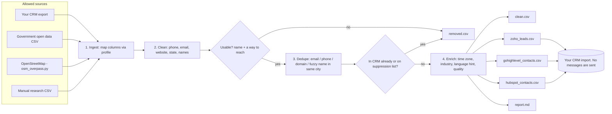

# List Pipeline: clean, dedupe, enrich, import

Turns messy business lists into clean, de-duplicated, CRM-ready CSV files for Zoho CRM, GoHighLevel and HubSpot.

- Local files in, local files out. It never contacts anyone.
- No scrapers for sites that forbid them. See [SOURCES.md](SOURCES.md) for what we use and the manual research path.
- No paid APIs. Python 3.9+, standard library only.

---

## What it does (1 paragraph)

You give it one or more CSV files: a state license list, a CRM export, an OpenStreetMap pull, a sheet your researcher filled by hand. It maps their different column names to one standard set, **cleans** each row (phone numbers to `+15550100001`, emails lowercase and valid, websites to `https://domain`, state names to two letters), **merges duplicates** (same email, phone, website domain, or nearly the same company name in the same city), **drops** anyone already in your CRM or on your do-not-contact list, **enriches** each record offline (time zone from state, industry from keywords, a Spanish-language hint, email type, a quality score), and writes import files for each CRM plus a report you check before importing.

## Diagram



## Files

| File | What it is |
|---|---|
| `pipeline.py` | The pipeline (`run`, `template`) |
| `profiles/generic.json` | Column aliases + industry keywords for most CSVs |
| `profiles/openstreetmap.json` | Column map for `osm_overpass.py` output |
| `sources/osm_overpass.py` | OpenStreetMap pull (prints the query; `--fetch` runs one request) |
| `samples/*.example.csv` | Fake example files: a messy registry export, manual research, a CRM export, a suppression list |
| `SOURCES.md` | Which sources are allowed, which are manual-only, and the manual research steps |
| `tests/test_pipeline.py` | Offline tests |

---

## 5-minute quick start (dry run)

Everything is local. Nothing is imported anywhere until you do it yourself.

```bash
cd data-pipeline

# 1. Run on the example files
python3 pipeline.py run samples/registry-export.example.csv samples/manual-research.example.csv \
    --existing samples/crm-export.example.csv \
    --suppression samples/suppression.example.csv \
    --out out
#    -> 9 rows in, 2 unusable, 2 duplicates merged, 1 already in CRM, 1 suppressed, 3 ready

# 2. Look at the results
cat out/report.md
#    open out/clean.csv in a spreadsheet: one row per business, best email first
#    open out/removed.csv: every dropped row and why

# 3. Make a blank sheet for manual research
python3 pipeline.py template research.csv

# 4. See what an OpenStreetMap query would look like (no network)
python3 sources/osm_overpass.py --tag craft=plumber --area "Austin" --out osm.csv

# 5. Run the tests (from the repo root)
cd .. && python3 -m unittest discover -s data-pipeline/tests -v
```

---

## Where to plug it in

Before every import:
1. Export what's already in your CRM (at least email and phone) and pass it as `--existing`.
2. Export your opt-outs, STOP list and do-not-contact records and pass them as `--suppression`.
3. Add a `--tag list-YYYY-MM` so you can find (or undo) the whole import later.
4. Import a **small test batch** first (10 rows), check it, then the rest.

Importing records **does not message anyone**. Enroll them in a journey later, on purpose, after the [going live checklist](../safety/README.md#going-live-checklist-15-checks).

### Zoho CRM

- Use `out/zoho_leads.csv`. In Zoho CRM: Leads > Import, choose the file, check the field mapping (the headers match Zoho's standard Lead field labels), and pick how to handle duplicates (for example, skip records whose email already exists).
- Zoho Leads require **Last Name** (and usually Company). When a row has no person, the pipeline puts the company name in Last Name.
- `Lead Source` is a picklist: add the values you use (`csv-import`, `manual-research`, `openstreetmap`) first, or map the column to a custom text field.
- Industry: map to the standard Industry field or your own custom field.

### GoHighLevel

- Use `out/gohighlevel_contacts.csv`. Contacts > Import, map the columns in the import screen (Business Name, Postal Code, Source, Tags...).
- The `Tags` column holds your `--tag`, the industry and the language, so you can build smart lists and trigger workflows by tag.
- Check your duplicate settings (email and/or phone) before importing.
- Texting imported contacts requires consent. The pipeline sets `sms_consent` to `no` for every row unless your source says otherwise.

### HubSpot

- Use `out/hubspot_contacts.csv`. Contacts > Import > File from computer, and confirm the column-to-property mapping. HubSpot de-duplicates contacts by email.
- `Industry` is a company property in HubSpot. Map it to a contact property you create, or import companies separately.
- Add a custom property for language and the import tag if you want to filter by them.

---

## Configuration reference

Command options:

| Option | What it does |
|---|---|
| `run FILE [FILE...]` | One or more input CSVs |
| `--profile PATH` | Column aliases and industry keywords (default `profiles/generic.json`) |
| `--out DIR` | Output folder (default `out/`) |
| `--existing CSV` | Records already in your CRM. Matching rows are dropped. Repeatable |
| `--suppression CSV` | Do-not-contact list (email / phone / website columns). Matching rows are dropped. Repeatable |
| `--tag TEXT` | Added to the Tags column of the GoHighLevel export |
| `template FILE` | Writes a blank CSV with the standard columns |

Profile (`profiles/*.json`):

| Key | What it does |
|---|---|
| `source` | Default value for the `source` column |
| `tag` | Default tag |
| `columns` | For each standard field, other column names that mean the same thing (`"phone": ["telephone", "business phone"]`) |
| `category_columns` | Columns used only to guess the industry (license type, NAICS description...) |
| `industry_keywords` | Industry name -> words. First match wins |
| `fuzzy_name_threshold` | 0-1. How similar two company names in the same city must be to merge (default 0.92) |

Standard columns: `company, first_name, last_name, title, email, phone, website, street, city, state, zip, country, industry, language, source, source_url, collected_on, notes, sms_consent`.

Added by the pipeline: `domain, timezone` (a `*` means the state spans two time zones; check the city), `email_type` (person / role / freemail), `language_hint` (`es?` when the company name looks Spanish; a hint, not a fact), `quality` (0-100), `ready` (has a company and a phone or email), `issues`, `dup_count`, `merged_sources`.

---

## Going live checklist (before an import)

1. Every input file comes from a source in the "allowed" table in [SOURCES.md](SOURCES.md), and its `source_url` / `source` is filled.
2. `--existing` and `--suppression` are fresh exports from today.
3. `report.md` numbers make sense (no surprise drop to 0, no 10x jump).
4. You spot-checked 10 random rows in `clean.csv` against their source.
5. Test import of 10 rows; fields land in the right CRM fields; the tag is there.
6. No workflow in your CRM fires on import that would message these records. Check "on create" rules before importing.
7. Full import, then record it in your change log (date, file, count, tag).

## Troubleshooting

| Symptom | Cause | Fix |
|---|---|---|
| Everything lands in `removed.csv` as "no name or no way to reach" | Columns not recognized | Add your column names to `columns` in the profile |
| Two different businesses merged | Same phone / domain (shared office or franchise) or very similar names in one city | Raise `fuzzy_name_threshold` to 0.96; review `dup_count` > 1 rows |
| Duplicates not merged | Different cities, or names too different | Expected. Clean them in the CRM's duplicate tool |
| `bad phone` in `issues` | Short or letters-only numbers | Fix at the source or leave blank |
| Website is empty but notes say "profile page" | It was a social page, not a company website | By design |
| Zoho import rejects rows | Lead Source picklist value missing | Add the value in Zoho or map to a text field |

## FAQ

**Why no scraper?** Because the sites people usually want to scrape forbid it, and lists built that way cause trouble with the sites, the law and deliverability. The OpenStreetMap pull and government downloads are allowed; everything else is manual research. See [SOURCES.md](SOURCES.md).

**Does it verify emails?** It checks the format and flags role and free-mail addresses. It does not ping mail servers. If you use an email verification service, run it on `clean.csv` before importing.

**Can I add my own enrichment?** Yes: add a step in `enrich()` in `pipeline.py`. Keep it offline or use only services whose terms allow it.

**Does it text or email anyone?** No. It only writes files.
