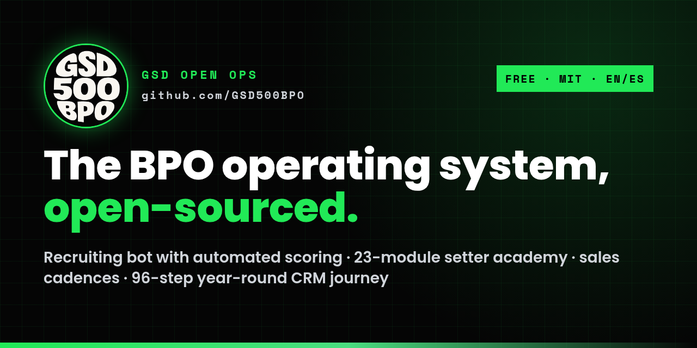

# GSD Open Ops

**Open-source appointment-setting and BPO operations kit**: a WhatsApp recruiting bot with automated candidate scoring, a 23-module setter academy (EN/ES), sales cadence templates, CRM ownership rules and a 96-step year-round CRM journey for home-service businesses. Free, MIT.

- **New here?** [Getting started, step by step](GETTING-STARTED.md)
- **Tools:** [24-step journey engine](https://github.com/GSD500BPO/gsd-open-ops/tree/main/journeys/24-step) · [speed-to-lead and hot-lead alerts](https://github.com/GSD500BPO/gsd-open-ops/tree/main/alerts) · [list pipeline](https://github.com/GSD500BPO/gsd-open-ops/tree/main/data-pipeline) · [safety layer](https://github.com/GSD500BPO/gsd-open-ops/tree/main/safety)
- **Code and files:** [github.com/GSD500BPO/gsd-open-ops](https://github.com/GSD500BPO/gsd-open-ops)
- **The story:** [How we built a BPO as a solopreneur with AI](how-we-built-it.md)
- **Use cases:** start with [100 applicants → a top 10](use-cases/recruiting-100-to-top-10.md) or [speed-to-lead routing](use-cases/speed-to-lead-routing.md)
- **The journey:** [96-step CSV](https://github.com/GSD500BPO/gsd-open-ops/blob/main/playbooks/96-step-journey/96-step-journey.csv) · [video](https://www.youtube.com/watch?v=fA0oPEkFEo4)

Want us to run it for you? → [Book a strategy call](https://gsd500bpo.com/strategy-call?utm_source=github&utm_medium=docs_site&utm_campaign=open-ops)
