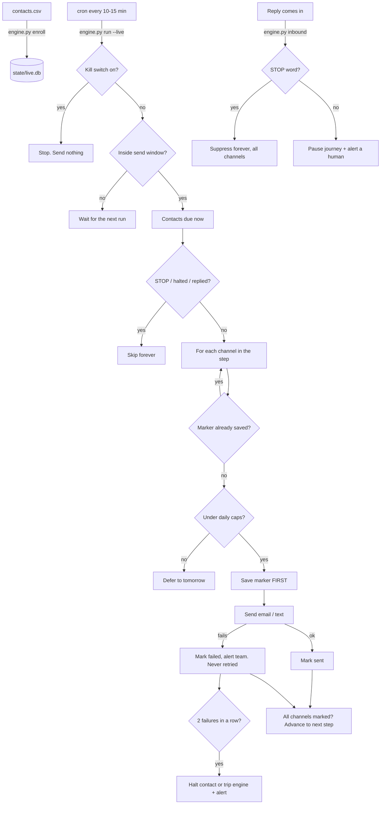

# 24-Step Nurture Journey Engine

A small program that follows up with your leads for 90 days, one step at a time, by email and (with consent) text. It is **dry by default**, it **never sends the same message twice**, and it **stops for good** when someone says STOP.

- 24 steps, 4 phases, 90 days. 24 emails, 6 texts.
- Plain-text templates you can edit in any text editor.
- Python 3.9+, standard library only. No paid services required.
- Works next to Zoho CRM, GoHighLevel, HubSpot, or a spreadsheet.

---

## What it does (1 paragraph)

You give it a list of contacts (a CSV). Every 10-15 minutes a scheduler runs `engine.py run`. For each contact whose next step is due, it fills in the step's template (name, company, your booking link) and sends it on each channel of that step: email, then text if the contact said yes to texts. Before every send it checks the safety rules: kill switch, STOP list, daily caps, and "was this exact message already sent?". It writes a "sent" marker **before** it sends, so a crash or a failed text can never cause a second email. If anyone replies, the journey pauses and a human gets an alert. If they say STOP, they are suppressed on every channel forever.

## Diagram



## The 24 steps

| Phase | Steps | Days | Goal |
|---|---|---|---|
| Introduce | 1-6 | 0, 2, 4, 7, 9, 11 | Open a conversation, name the problem, ask permission |
| Educate | 7-12 | 14 to 29 | Give useful rules they can use without you |
| Prove | 13-18 | 33 to 53 | Show how the work is done and measured |
| Decide | 19-24 | 58 to 90 | Ask clearly, then say goodbye politely |

Texts go out on steps 1, 4, 8, 13, 19 and 23, only to contacts with `sms_consent=yes`. The full list is in [`journey.json`](journey.json). The copy is in [`templates/en/`](templates/en/).

## Files

| File | What it is |
|---|---|
| `journey.json` | The journey: steps, day of each step, channels, stop rules, channel rules |
| `templates/en/step-NN.email.txt` | Email copy. First line is `Subject: ...` |
| `templates/en/step-NN.sms.txt` | Text copy. Must include "Reply STOP to opt out" |
| `config.example.json` | Your name, company, links, send window, caps, providers. Copy to `config.json` |
| `.env.example` | Passwords and keys. Copy to `.env` and `chmod 600 .env` |
| `contacts.example.csv` | Example contact list (fake data) |
| `engine.py` | The engine (commands below) |
| `providers.py` | How messages are sent: dry run, SMTP email, Twilio SMS, or a webhook to your own tool |
| `tests/test_engine.py` | Offline tests that prove the safety rules |
| `../../safety/` | The shared guard (markers, caps, STOP list, breaker, kill switch) and the team-chat notifier |

---

## 5-minute quick start (dry run)

Nothing in these steps sends a real message.

```bash
cd journeys/24-step

# 1. Check the journey, the templates and the config
python3 engine.py check
#    -> check OK (24 steps, dry-run config)

# 2. Enroll the example contacts (into state/dry-run.db)
python3 engine.py enroll contacts.example.csv
#    -> enrolled 3, skipped 1   (the skipped one has do_not_contact=yes)

# 3. Run once. --ignore-window lets you test at night or on a weekend
python3 engine.py run --ignore-window
#    -> prints each email and text it WOULD send

# 4. Run again right away: nothing new is sent (idempotency)
python3 engine.py run --ignore-window

# 5. Pretend time passed: step 2 comes due (any future date works;
#    each run moves a contact at most one step, at least 20 hours apart)
python3 engine.py run --ignore-window --now 2030-01-01T15:00:00Z

# 6. Simulate a reply and a STOP
python3 engine.py inbound --from ben@example.com --text "Call me Tuesday" --channel email
python3 engine.py inbound --from +15550000001 --text "STOP"

# 7. See where everyone is
python3 engine.py status

# 8. Run the safety tests (from the repo root)
cd ../.. && python3 -m unittest discover -s journeys/24-step/tests -v
```

Start over any time: delete `journeys/24-step/state/dry-run.db`.

To see one message with real merge fields: `python3 engine.py preview --contact c-001 --step 1`.

---

## Make it yours

1. `cp config.example.json config.json`
2. Fill every `CHANGE-ME` and every `example.com` in `config.json`: your name, company, website, **mailing address** (required by US anti-spam law in every commercial email), booking link and unsubscribe link.
3. Edit the copy in `templates/en/`. Keep `{{unsubscribe_link}}` and `{{physical_address}}` in every email and "Reply STOP to opt out" in every text. `engine.py check` refuses templates without them.
4. Change days or channels in `journey.json`. Days must go up. You can add or remove steps.
5. Run `python3 engine.py check` after every change.

### Merge fields

Write `{{field}}` or `{{field|fallback}}`. Example: `Hi {{first_name|there}},`.

| Field | Comes from |
|---|---|
| `first_name`, `last_name`, `company`, `city`, `state`, any CSV column | the contact row |
| `sender_name`, `sender_company`, `sender_website`, `physical_address`, `booking_link`, `unsubscribe_link`, `trade`, `offer_short` | `merge` in `config.json` |
| `contact_id` | the contact's id (useful inside `unsubscribe_link`) |

If a field is empty and has no fallback, **that message is skipped, not sent**, and you get an alert. A half-filled message never goes out.

### Contact CSV columns

| Column | Required | Notes |
|---|---|---|
| `id` | recommended | Your CRM record id. If empty, email or phone is used |
| `email` | for email steps | |
| `phone` | for text steps | E.164 is best: `+15550000001` |
| `sms_consent` | for text steps | `yes` only if the person agreed to receive texts |
| `do_not_contact` | no | `yes` = never enrolled |
| `in_other_journey` | no | `yes` = never enrolled (one automation per lead) |
| `first_name`, `company`, `city`... | no | Anything you want to merge |

---

## Where to plug it in

The engine needs three things from your CRM: **who to enroll**, **replies and STOPs**, and (optional) **opens, clicks and bookings**. It gives back: what was sent, and status changes.

Recommended custom fields (any CRM):

| Field | Type | Values |
|---|---|---|
| Journey Status | picklist | Active, Replied, Stopped, Completed, Won, Halted |
| Journey Step | number | 1-24 |
| SMS Consent | checkbox | checked only with documented consent |
| Preferred Language | picklist | English, Spanish |
| Do Not Contact | checkbox | checked = never enroll |

### Zoho CRM

- **Who to enroll:** build a list view (for example: Lead Status = New, Do Not Contact unchecked, Email Opt Out unchecked), export it to CSV, then `engine.py enroll export.csv`. Use the Zoho record id as `id`.
- **Replies and STOPs:** inbound texts come from your SMS provider, not from Zoho. Point your SMS provider's inbound-message webhook at a small script that calls `engine.py inbound --from ... --text ...` (or wire it through the `alerts/` webhook receiver). For email replies, check replies in your inbox or use your mail provider's forwarding rules.
- **Opens, clicks, bookings:** a Zoho workflow rule can call a **Webhook** action (Setup > Automation > Actions > Webhooks) when a field changes, for example when a Booked checkbox is ticked. Send it to your own endpoint that runs `engine.py event --contact <id> --type booked`.
- **Sending through Zoho instead of SMTP:** set `providers.email.type` to `webhook` and point `EMAIL_WEBHOOK_URL` at a Zoho CRM function exposed as a REST API (Setup > Developer Hub > Functions). The function sends the email. Availability depends on your edition, so check your plan.
- **Watch out:** in our experience, deactivating a Zoho workflow rule did **not** cancel actions that were already scheduled. If Zoho also has a cadence or workflow sending to the same leads, turn it off and check its scheduled actions, so only one engine messages a lead.

### GoHighLevel

- **Who to enroll:** filter contacts (for example by tag), export to CSV, then `engine.py enroll`. Or build a workflow with a **Webhook** action that posts new contacts to your endpoint.
- **Replies:** the **Customer Replied** workflow trigger plus a **Webhook** action can post replies to your endpoint, which calls `engine.py inbound`.
- **STOP:** if you send texts through GoHighLevel's own phone system, it handles STOP replies and sets Do Not Disturb (DND) for that channel. Still send STOPs to the engine so it suppresses every channel.
- **Sending through GoHighLevel:** set the provider type to `webhook` and point it at a workflow that starts with an **Inbound Webhook** trigger and sends the email or SMS. Inbound webhook triggers are a premium feature on some plans, so check your plan.
- Use GoHighLevel's per-channel **DND** settings as your Do Not Contact field.

### HubSpot

- **Who to enroll:** export a contact list or view to CSV, then `engine.py enroll`.
- **Replies and bookings:** HubSpot workflows can **send a webhook** when a property changes (for example a reply logged or a meeting booked). This action needs Operations Hub / Data Hub Professional or higher, so check your plan. Without it, a developer can poll the HubSpot CRM API with a private app token.
- **Unsubscribes:** HubSpot manages subscriptions for emails sent **by HubSpot**. Emails sent by this engine are outside HubSpot, so record our unsubscribes in your own Do Not Contact property and include them when you export.
- **Sending through HubSpot:** possible with a webhook-triggered workflow on higher plans. Check your plan before you design around it.

### No CRM yet?

Use a spreadsheet: export it as CSV, enroll, and run. Keep `state/live.db` backed up; it is the record of what was sent.

---

## Configuration reference

`config.json`:

| Key | Default | What it does |
|---|---|---|
| `sender_id` | `nurture-24` | Name of this engine. Used in kill files (`KILL_nurture-24`) and markers |
| `state_dir` | `state` | Where the databases, `alerts.log` and kill files live |
| `journey_file` | `journey.json` | The journey definition |
| `templates_dir` | `templates/en` | Folder with `step-NN.email.txt` / `.sms.txt` |
| `merge.*` | (fill in) | Values for your merge fields |
| `send_window.timezone` | `America/New_York` | Time zone for the send window |
| `send_window.days` | mon-fri | Days when sending is allowed |
| `send_window.start_hour` / `end_hour` | 9 / 17 | Hours when sending is allowed (end is not included) |
| `caps.email_per_address_per_day` | 1 | Max emails to one address per day |
| `caps.sms_per_address_per_day` | 1 | Max texts to one number per day |
| `caps.touches_per_contact_per_day` | 2 | Max messages to one contact per day, all channels |
| `circuit_breaker_failures` | 2 | Failures in a row that halt a contact (per channel) or stop the engine (per channel, across contacts) |
| `max_contacts_per_run` | 50 | Contacts handled per run. Keeps a mistake small |
| `providers.email.type` | `smtp` | `smtp` or `webhook` |
| `providers.sms.type` | `twilio` | `twilio` or `webhook` |
| `events_out` | `state/events.jsonl` | Replies, STOPs, opens and clicks written here for the `alerts/` module |

`journey.json`:

| Key | What it does |
|---|---|
| `steps[].id` / `day` / `channels` / `template` | Step id, days after enrollment, channels in order, template file prefix |
| `min_hours_between_steps` | Minimum gap between two steps for one contact (default 20) |
| `channel_rules.sms.requires` | Fields that must be set before a text: `phone`, `sms_consent` |
| `channel_rules.sms.only_if_engaged` | `true` = texts only after an open, click or reply |
| `stop_rules` | Documentation of what each event does (the code enforces them) |

`.env`: `SMTP_HOST`, `SMTP_PORT`, `SMTP_USER`, `SMTP_PASSWORD`, `TWILIO_ACCOUNT_SID`, `TWILIO_AUTH_TOKEN`, `EMAIL_WEBHOOK_URL`, `SMS_WEBHOOK_URL`, `WEBHOOK_SECRET` (signs webhook calls with `X-Signature-SHA256`), `ALERT_WEBHOOK_URL`, `ALERT_WEBHOOK_FORMAT`.

### Safety rules (always on)

| Rule | How |
|---|---|
| Dry run by default | Without `--live`, providers are replaced by a printer and state goes to `dry-run.db` |
| Live needs a clean check | `--live` runs `check` first and refuses to start on any problem |
| One message per channel per step | A marker is saved **before** sending. A marked channel is never sent again |
| Daily caps | Per address per channel, and per contact across channels |
| STOP is forever | STOP, unsubscribe = suppressed on every channel. Enroll refuses them, even with a new id |
| Circuit breaker | 2 failures in a row on a channel: contact halted, or engine stopped (`state/KILL_nurture-24`) |
| Loud errors | Every failure, halt and trip goes to `state/alerts.log` and, live, to your team chat |
| Kill switch | `touch state/KILL_ALL` or `python3 ../../safety/guard.py kill --dir state` |

---

## Going live checklist

Do every item. If one fails, do not go live. (The full version is in [`safety/README.md`](../../safety/README.md#going-live-checklist-15-checks).)

1. Write down the scope: audience, territory, channels, the From address per language, the one number that texts.
2. `python3 -m unittest discover -s journeys/24-step/tests` passes on the machine that will send.
3. `python3 engine.py check --live` says OK (no `CHANGE-ME`, no `example.com`, providers configured).
4. Caps and breaker are at their defaults or lower.
5. `ALERT_WEBHOOK_URL` is set and `python3 ../../alerts/alerts.py test-alert --live` shows up in your team chat.
6. Failure paths tested: wrong SMTP password, wrong Twilio token, unreachable webhook. The log shows each failure once, no repeats.
7. Balances checked: SMS credits, email sending limits, any per-day provider limits.
8. Suppression imported: every past STOP and unsubscribe (`python3 ../../safety/guard.py suppress --db state/live.db --address ...`). No other workflow sends to the same leads.
9. Segments right: language matches the templates, send window matches the audience's time zone.
10. Nobody else gets copies (no BCC to third parties) unless agreed and tested.
11. Enroll **yourself** first (your own email and phone) and run every step with `--now` in a dry run, then one live step to yourself.
12. Two "go"s from the owner: one on the test, one naming the audience and the count.
13. Watch the first live run, and again one hour later (`engine.py status --live`, `state/alerts.log`).
14. Kill switch written down as one command, where the team can find it.
15. Log the change (date, who, audience, count) in your change log.

Then add the cron line:

```cron
*/15 * * * * cd /path/to/gsd-open-ops/journeys/24-step && /usr/bin/python3 engine.py run --live >> state/run.log 2>&1
```

---

## Troubleshooting

| Symptom | Likely cause | Fix |
|---|---|---|
| `outside the send window; nothing to do` | Run outside `send_window` | Normal. In a dry run, add `--ignore-window` |
| `KILL SWITCH ON (...)` | A `KILL_*` file exists in `state/` | Read the reason in the file. Fix the cause, then `python3 ../../safety/guard.py resume --dir state --sender nurture-24` (or delete the file) |
| `N problem(s). Live run refused.` | `check --live` found placeholders or missing keys | Fix each `PROBLEM:` line |
| Contact never gets texts | No `sms_consent=yes`, no phone, or suppressed | `engine.py status`; check the CSV |
| `could not render ...` alert | A merge field is empty and has no fallback | Add a fallback (`{{first_name|there}}`) or fill the value in `config.json` |
| A message shows as `sending` under `stuck_sending` | The process died during a send | It will **not** be re-sent. Check your provider to see if it went out |
| Contact `halted` | 2 failures in a row on one channel | Fix the cause (bad number, bounced email). Halted contacts stay halted on purpose |
| Nothing happens in cron | Wrong path or Python | Use absolute paths; check `state/run.log` |

## FAQ

**Why doesn't it retry a failed send?** Because automatic retries are how one email turns into dozens. A failed send is logged and alerted. A human decides.

**Can I send the same step again to someone on purpose?** Not through the engine. Send it by hand. This is deliberate.

**Can someone who said STOP be re-enrolled?** Not automatically, not even with a new id. If they later give written consent again, a developer must remove the row from the `suppression` table by hand and keep a note of the consent.

**Is this legal?** The rails help (unsubscribe link, mailing address, STOP handling, consent for texts), but laws differ by country and state. In the US, read the CAN-SPAM rules for email and the TCPA rules for texts, and talk to a lawyer. This is not legal advice.

**Will my emails land in spam?** That depends on your domain setup (SPF, DKIM, DMARC), your sending volume and your list quality. Start small (the caps help) and use a domain with a good reputation.

**Can I add Spanish?** Yes. Copy `templates/en` to `templates/es`, translate, and run a second engine with its own `config.json` (`templates_dir: templates/es`, its own `sender_id`). Enroll each contact in one language only.

**Can I use WhatsApp?** Add a provider with a `send()` method in `providers.py` and the channel name in `journey.json`. WhatsApp business messages outside a 24-hour reply window need approved templates.

**Where is the data?** In `state/live.db` (SQLite). Back it up. Open it with any SQLite viewer.
