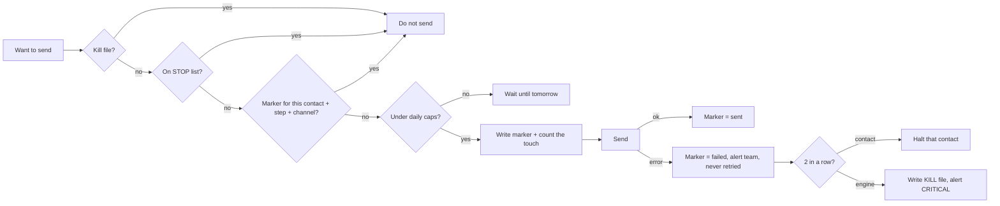

# Safety layer (shared by every sender)

Two small files that every runner in this repo uses:

| File | What it does |
|---|---|
| [`guard.py`](guard.py) | Kill switch, "sent" markers (idempotency), daily caps, permanent STOP list, circuit breaker, fail-closed |
| [`notify.py`](notify.py) | Posts errors and alerts to your team chat (Slack, Google Chat, Mattermost, Zoho Cliq, Discord, or your own endpoint) and always writes them to `alerts.log` |

## Why this exists

We had a follow-up engine that sent an email, then tried a text. The text provider ran out of credits. The step never advanced, so every few minutes the scheduler ran the whole step again, **email included**. A couple of leads got the same email dozens of times, and nobody was told for hours.

Nothing about that was exotic. It is the default behavior of most "send, then mark done" scripts. So every sender here follows these rules, and the tests prove them.

## The rules



1. **Dry run by default.** Runners need `--live` to send.
2. **Idempotency per channel per step.** The marker is written **before** the send. A marked channel is never sent again, whether the send worked, failed or crashed halfway.
3. **Daily caps.** Per address per channel (default 1 email, 1 text) and per contact across channels (default 2).
4. **STOP is permanent.** STOP, unsubscribe and similar words (English and Spanish) suppress the contact on every channel. There is no code path that removes a suppression or re-enrolls the contact.
5. **Circuit breaker.** 2 failures in a row on a channel for one contact halts that contact. 2 failures in a row on a channel across contacts stops the engine by writing `KILL_<sender>`.
6. **Fail closed.** If the guard itself errors (database locked, disk full), nothing is sent.
7. **Loud errors.** Every failure, halt and trip goes to `alerts.log` and, in live mode, to your team chat.

## Commands

```bash
# What's going on?
python3 safety/guard.py status --db journeys/24-step/state/live.db

# STOP EVERYTHING (every sender that uses this state folder)
python3 safety/guard.py kill --dir journeys/24-step/state --reason "checking a complaint"

# Stop one sender only
python3 safety/guard.py kill --dir journeys/24-step/state --sender nurture-24

# Resume (only after you fixed the cause)
python3 safety/guard.py resume --dir journeys/24-step/state
python3 safety/guard.py resume --dir journeys/24-step/state --sender nurture-24

# Someone asked by phone not to be contacted: suppress them forever
python3 safety/guard.py suppress --db journeys/24-step/state/live.db --address +15550000001 --reason "asked by phone"
```

`touch state/KILL_ALL` works too. Delete the file to resume.

## Using the guard in your own sender

```python
import guard, notify
n = notify.Notifier("state/alerts.log", live=LIVE)
g = guard.Guard("state/live.db", "my-sender", notifier=n)

ok, why = g.reserve(contact_id, step_id, "email", email_address)   # writes the marker BEFORE the send
if ok:
    try:
        provider.send(...)
        g.complete(contact_id, step_id, "email", True, message_id)
    except Exception as e:
        g.complete(contact_id, step_id, "email", False, str(e))      # alerts; may halt or trip; never retried
```

## Team chat formats

Set `ALERT_WEBHOOK_URL` to an incoming-webhook URL from your chat tool and pick `ALERT_WEBHOOK_FORMAT`:

| Format | JSON sent | Works with |
|---|---|---|
| `text` (default) | `{"text": "..."}` | Slack incoming webhooks, Google Chat, Mattermost, Rocket.Chat, Zoho Cliq channel webhooks |
| `discord` | `{"content": "..."}` | Discord webhooks |
| `generic` | `{"level", "text", "source"}` | Your own endpoint, n8n, Make, Zapier catch hooks |

Microsoft Teams webhooks change often; use `generic` through n8n/Make/Zapier, or adapt `notify.py`.

## Going live checklist (15 checks)

Every item must pass before any automated email, text or WhatsApp sender goes live, is turned back on, or is changed. If one fails, it's a no-go.

1. **Scope written down:** audience, territory, channels, the From address per language, the one phone number that sends texts.
2. **Idempotent per channel:** "sent" is saved before the next channel or API call. A failure never re-sends another channel. (Built in; run the tests.)
3. **Hard caps in code:** at most 1 email per lead per step, at most 2 touches per lead per day.
4. **Circuit breaker:** 2 consecutive failures stop that lead; repeated errors stop the engine. Fail closed on bad tokens (401) or guard errors.
5. **Errors reach a human fast:** every error goes to team chat within 10 minutes. Test the alert (`python3 alerts/alerts.py test-alert --live`).
6. **Failure paths tested in a dry run:** out of credits (402), rate limited (429), bad token (401), SMTP login error (535), timeout. The log must show zero repeats.
7. **Balances checked and noted:** SMS credits, email provider limits, ad or messaging account status, WhatsApp messaging tier.
8. **Suppression complete:** opt-outs per channel, STOP lists, recent message history checked, **one engine per lead** (no overlap with CRM workflows or other tools).
9. **Segments right:** each audience gets its own journey (or is held), language matches, quiet hours, weekends and holidays respected.
10. **Third-party copies:** anyone else who gets a copy (BCC to a partner, a notice to a client) gets no personal data before the agreed handoff, and is test-sent first.
11. **Tested on yourself:** every step sent to your own inbox and phone.
12. **Two explicit "go"s from the owner:** "approved" on the test, then "send" naming the audience and the count. No skipped checks without the owner approving each one.
13. **Watch it:** the first live run and again one hour later (log + recipients). Report what was checked and what wasn't.
14. **Kill switch is one command,** written down where the team can find it. Remember: turning off a CRM workflow may not cancel actions it already scheduled.
15. **Logged:** change log entry, README updated, team SOPs updated.

## Tests

The rules are proven by offline tests in each module:

```bash
python3 -m unittest discover -s journeys/24-step/tests -v
python3 -m unittest discover -s alerts/tests -v
```
